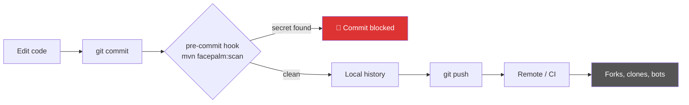
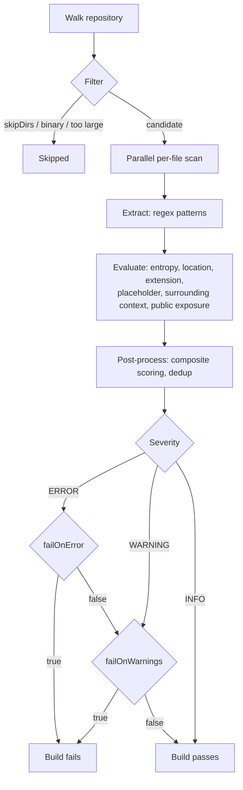

# 🤦‍♂️ Facepalm Maven Plugin

[](https://central.sonatype.com/artifact/dev.nichar/facepalm-maven-plugin)
[](https://github.com/nikolas-charalambidis/facepalm-maven-plugin/actions/workflows/build.yaml)
[](LICENSE)
[](https://openjdk.org/projects/jdk/17/)
[](https://scorecard.dev/viewer/?uri=github.com/nikolas-charalambidis/facepalm-maven-plugin)
[](https://www.bestpractices.dev/projects/16636)

One commit.  
One leaked API key.  
One **$55,444.78 bill**.

That’s not hypothetical. It actually happened to a student who accidentally exposed their Google Cloud credentials publicly:

https://www.reddit.com/r/googlecloud/comments/1noctxi/student_hit_with_a_5544478_google_cloud_bill

Once a secret hits Git, it’s not “deleted”.  
It’s **forever**. In history, forks, clones, caches, bots.

---

## What this plugin does

**Facepalm** scans your entire repository and stops you before you:

- Commit API keys
- Leak passwords
- Push tokens
- Accidentally publish secrets that cost real money

The goal is simple: stop the mistake before it leaves your machine.

---

## Why you want this

- Secrets leak silently
- Bots scan GitHub constantly
- Abuse starts within minutes
- Cleanup is painful (and often impossible)

This is a guardrail, not a report.



---

## Recommended setup (important)

Add it to your `pom.xml`:

```xml
<plugin>
    <groupId>dev.nichar</groupId>
    <artifactId>facepalm-maven-plugin</artifactId>
    <version>1.0.2</version>
    <executions>
        <execution>
            <goals>
                <goal>scan</goal>
            </goals>
        </execution>
    </executions>
</plugin>
```

To be effective, hook it into a Git pre-commit hook.
Running it only in CI is too late: by then the secret may already be in Git history.

```sh
.git/hooks/pre-commit
```
```sh
#!/bin/sh

mvn -B -ntp facepalm:scan
RESULT=$?

if [ $RESULT -ne 0 ]; then
    echo "Facepalm: potential secret detected. Commit blocked."
    echo "Check the Maven output above for details."
    exit 1
fi

exit 0
```

Make it executable:

```bash
chmod +x .git/hooks/pre-commit
```

---

## How it works



---

## Philosophy

You don’t need another report.
You need a hard stop before damage happens.
Zero regret.

___

## Documentation

- [Configuration](docs/configuration.md) - Parameters, defaults, and examples.
- [Git Hooks](docs/git-hooks.md) - Pre-commit and pre-push setup.
- [Detection Patterns](docs/patterns.md) - What is detected and how to extend.
- [Reporting](docs/reporting.md) - How to generate reports.
- [FAQ](docs/faq.md) - False positives, performance, and more.
- [Site](https://www.nikolas-charalambidis.com/facepalm-maven-plugin/) - Site

___

## License

This project is licensed under the Apache License, Version 2.0 - see the [LICENSE](LICENSE) file for details.

___

## Disclaimer

**IMPORTANT: This software is provided "as is", without warranty of any kind.**  
The author(s) are not responsible for any damage, data loss, or security breaches caused by the use (or misuse) of this plugin. While Facepalm is designed to catch secrets, no tool is 100% accurate. You are solely responsible for your own security and credentials.
