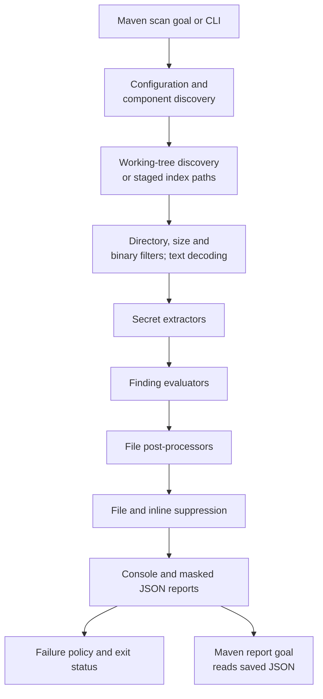

# Architecture

Facepalm is a single-module Java 17 Maven plugin with a standalone CLI. This guide describes the development
branch, not a promise that every capability is in the latest published release. Start with the
[requirements](requirements.md), [decision records](adr/README.md), and [roadmap](roadmap.md).

## Scan data flow

1. `FacepalmMojo` maps Maven parameters into `FacepalmConfig`; `FacepalmCLI` maps picocli options into the same
   configuration types. Both create a Guice injector with configuration/logging modules. The Mojo discovers
   components from Sisu's generated index using `BeanScanning.INDEX`; the CLI scans the classpath at runtime using
   `BeanScanning.CACHE`. A component missing from the index can work in the CLI but disappear in Maven.
   Maven logging is adapted to `FacepalmLog`; the scanning core does not need Maven APIs.
2. `FacepalmRunner` removes earlier findings/statistics files before scanning so an aborted run cannot leave stale
   results that appear current. `ScannerEngine` validates the root and thread count, loads Git state and file
   suppressions, and discovers eligible paths. It prunes configured directories, checks size and binary filename
   exclusions, and decodes supported text encodings. Files with binary content are excluded too.
3. A full scan reads working-tree bytes. CLI `--staged` instead selects staged additions/modifications and reads
   their Git index blobs. Deleted files and submodules are excluded. A secret removed only from the working copy
   still exists in a staged blob and can fail the scan. Directory and size filters still apply.
4. Qualified files run on a fixed thread pool. Each file gets a `FileContext` with its path, relative path, decoded
   content and lines. `SecretExtractor` implementations return findings; the regex extractor uses the pattern
   registry, identifies captures, masks snippets and deduplicates overlapping matches.
5. Each `FindingEvaluator` adjusts risk/confidence using entropy, extension, location, placeholders, surrounding
   context or Git exposure. Scores are clamped to 0–100 after each adjustment. Evaluator ordering can therefore
   affect results; do not assume the evaluators commute.
6. `FileFindingsPostProcessor` implementations see the whole file's findings. Composite scoring accounts for
   multiple pattern types and high-volume noise, while preserving format-specific secrets and capping Maven
   encrypted values below ERROR. File and inline suppressions apply after these adjustments. Unused suppression
   entries/markers produce diagnostics.
7. The runner logs results and writes masked findings and statistics JSON. It then applies the configured failure
   policy. Finding failures and, when enabled, incomplete scans fail the Maven goal or return a nonzero CLI status.
   Results remain available for diagnosis after a policy failure.

`.gitignore` is an exposure signal, not an exclusion list: an ignored, untracked file can still be scanned and gets
a risk discount. Tracked files retain public exposure even if an ignore rule matches. See [ADR 0005](adr/0005-git-ignore.md).

## Module boundaries

| Package | Responsibility |
|---|---|
| Root package | Maven goals, CLI entry point and shared configuration aggregate |
| `config` / `configurator` | Configuration values / Maven collection conversion and binding |
| `module` | Guice configuration and logging adapters |
| `pattern` | Pattern definitions, registry and value classification; no dependency on other plugin packages |
| `engine` | Discovery, Git state, decoding, findings, scoring, suppression and orchestration |
| `engine.extractor` / `engine.evaluator` / `engine.postprocessor` | Per-file analysis extension points |
| `report` | Console output, masked DTOs and report rendering |

The engine and report packages do not depend on Maven. Extractors, evaluators, post-processors and patterns do not
depend on reporting. Guice/Plexus access is confined to adapters and entry points. `ArchitectureTest` enforces these
boundaries. Its package-cycle check explicitly allows `ScoringConfig` to use the engine's `ScoringStrategy`, and
`FacepalmRunner` to orchestrate reporting; these are existing exceptions, not permission for new cycles.

## Extending the scanner

- **Patterns:** register a `SecretPattern` in `SecretPatternRegistry`. Add positive/negative registry and sample
  tests, backtracking coverage, a real-file integration fixture and user documentation. Patterns should capture
  the secret value and prefer specific provider formats. User-supplied additive patterns are still planned
  ([#79](https://github.com/nikolas-charalambidis/facepalm-maven-plugin/issues/79)).
- **Evaluators:** implement `FindingEvaluator`, annotate the component with `javax.inject.Named` and use
  `javax.inject.Inject` for dependencies. Adjust findings through their scoring API so changes are recorded.
  Add focused tests and a fixture when introducing an evaluator.
- **Extractors/post-processors:** implement `SecretExtractor` or `FileFindingsPostProcessor` respectively, with
  the same component annotations. These run concurrently across files; avoid mutable per-file singleton state.
- **Wiring:** the build generates `META-INF/sisu/javax.inject.Named`. Maven uses this index through
  `BeanScanning.INDEX`, while the CLI uses `BeanScanning.CACHE` to scan the classpath at runtime. A missing index
  entry can therefore leave a component working in the CLI but absent in Maven. Ensure new components are indexed;
  a successful CLI scan alone does not verify Maven wiring. The injector supplies implementations of the three
  interfaces as lists. `ComponentWiringTest` verifies indexed components and complete extension lists.
  Do not introduce an assumed ordering contract between discovered implementations.

## Outputs and contracts

`facepalm-findings.json` is a JSON array; `facepalm-statistics.json` is separate scan metadata. Secrets and context
are masked before serialization. The Maven report goal reads saved JSON and renders the site report; it does not
perform another scan. HTML and SARIF utility methods also exist in `Reporter`, but automatic output selection for
them remains [planned work](https://github.com/nikolas-charalambidis/facepalm-maven-plugin/issues/80).

The default strategy is `WEIGHTED_QUADRATIC`, with ERROR at 80 and WARNING at 40. `failOnError` defaults to true,
`failOnWarnings` to false. Suppressed findings do not fail the build. `failOnScanError` is opt-in; otherwise failed
paths are reported while other files continue. These choices are compatibility-sensitive, as recorded in
[ADR 0003](adr/0003-scoring-contract.md).

See the existing [configuration](https://github.com/nikolas-charalambidis/facepalm-maven-plugin/blob/master/docs/configuration.md)
and [reporting](https://github.com/nikolas-charalambidis/facepalm-maven-plugin/blob/master/docs/reporting.md) guides
for parameter and output details. Scanning uses local files and local Git commands; Maven dependency resolution,
site generation and documentation link checks are separate operations that may access the network.
